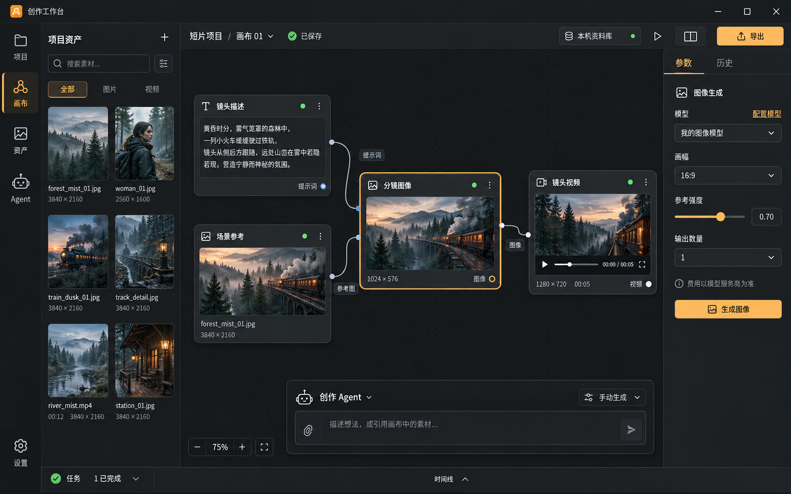

# 桌面工作台视觉方向

2026-10-24。使用内置 Image Gen 生成的第一版视觉探索，不是已经实现的软件截图。用户已批准整体 Electron 产品方案，尚未对这张具体视觉稿给出反馈。

## 视觉参考

提示词保存在 workspace-concept-v1-prompt.txt。

## 实现方法

1. 用概念图讨论整体空间、色彩和工作流；界面文字、按钮、图标不从大图切成贴图。
2. 提取灰阶、强调色、文字层级、间距、节点与面板 token。
3. Electron 本地 renderer 使用 React 组件；节点/边交互使用 React Flow；文件操作和模型调用遵循已批准的引擎边界。
4. 先完成画布工作台，再复用设计系统扩展项目、资产、Agent、任务和模型设置。
5. 真实状态涵盖空项目、上传中、生成中、错误、待审批、离线和冲突；概念图里的已完成样例不能冒充实际任务。
6. 实现后对照截图检查布局、尺寸、字体、间距、颜色和高 DPI 适配。

## 初稿观察

- 深灰背景，少量琥珀色标记当前操作；画布保留足够空间。
- 左侧资产抽屉、中间节点图、右侧参数检查器、底部可收起 Agent。
- 正式实现需支持关闭资产/参数面板，避免小窗口画布过窄。
- 图片里的模型名称和媒体内容是演示；实际连接与素材由用户配置或导入。
- 初稿右上角导出按钮只在对应能力实现后启用，不提前表现为可用功能。
