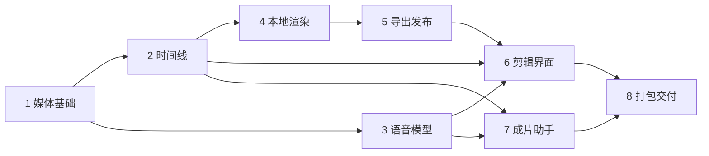

# P4 Audio, Timeline and Film Export Implementation Plan

> **For agentic workers:** REQUIRED SUB-SKILL: Use superpowers:subagent-driven-development or superpowers:executing-plans to implement this plan task-by-task. Steps use checkbox syntax. No nested agents; share exact produced interfaces and evidence at each handoff.

**Goal:** 在现有本机 MovieAgent 中完成镜头→剪辑→配音/音轨→中文字幕→1080p成片的可恢复闭环。

**Architecture:** 继续使用命令/查询/事件与固定媒体引用。React编辑不可变时间线；特权媒体运行时提供受限探测/归一化/FFmpeg；云端语音复用P2费用和任务体系，本机渲染用独立持久队列。所有导出冻结版本，主进程只向当前短剧目录发布。

**Tech Stack:** 现有TypeScript、Node24、Electron45、React19、SQLite、Vitest/Playwright；新增随包FFmpeg/ffprobe与固定CJK字体。候选FFmpeg9.0.2 essentials x64、Noto Sans CJK SC Regular Sans2.004，先验真实构建，不先升级现有依赖。

**Spec:** `docs/superpowers/specs/2026-10-27-p4-audio-timeline-design.md`

**P4扩展入口：** [角色声音与对白制作六项计划](2026-10-27-p4-character-voice.md)现为P4必读部分。执行基础Task1–7后接V1–V6，再执行本文件Task8；不要执行完旧八项就宣布P4全部完成。

**Status:** 2026-10-27用户已授权开始实施，实施起点为 `10250b7`。顺序仍为基础1–7→V1–V6→基础8。已有MiniMax订阅Key的单句TTS与ASR真实测试通过；开发仍使用fixture，不自动扩大真实调用。逐项完成以执行记录和验收证据为准。

## Global Constraints

- 工作目录 `D:/movieAgent/libtv-studio`；保留既有分支/本机目录偏好，不触碰D:/rea、真实config/models.json、用户资料库、运行中的MovieAgent或旧release。仅创建release-p4。
- Windows工具使用 `D:/nodejs/node.exe`、`C:/Program Files/Git/bin/bash.exe`；测试始终指定临时库、临时user-data和fixture模型配置。开发不调用真实音频/文本/图像/视频服务。
- 所有产品时间为48000 ticks/s；帧率归每条时间线，仅24/25/30、den=1，默认30；有任何内容时fps锁定。区间左闭右开；视频/字幕端点对齐帧，音频对齐采样。画幅1920×1080/1080×1920/1080×1080、SDR BT.709、48kHz输出音频。
- 每时间线≤600秒、64视频片段、每附加音频轨128片段、1000字幕条、每条≤200字符；每批≤100操作/1MiB。gainMilli0–2000，默认1000；旧无对白元数据视频原声默认静音，专项原生对白开启原声、补配修正版只用独立音轨。
- 音频导入≤128MiB/600秒，ASR上传≤24,000,000字节/600秒，TTS每条≤4000字符、批次≤16条/16000字符。MP4输出≤1GiB、WAV≤128MiB、预览≤256MiB、素材ZIP≤2GiB；旧网络模型媒体上限不放大。
- P3固定引用可为artifact或assetVersion；时间线明确支持两者，不强制额外发布资产版本。捕获原始生产修订，未知来源标未知；新选择尊重回收站，冻结历史可读取。
- 同一资料库同时仅1个重型媒体作业，编码线程≤4，探测30秒超时、渲染30分钟超时、取消5秒后仅终止持有的本作业进程；shell:false、windowsHide:true。数据块≤1MiB、每读会话≤2块并行。
- 不新增任意路径/FFmpeg参数/网络的renderer能力。不把file协议白名单当作OS沙箱；明确demuxer/流/资源限制。
- 基础迁移0015–0019，角色对白专项追加0020–0023，顺序与负责人见两份任务计划；0023补充审核上下文及整批批准，不得改写既有迁移。schema升级备份、旧DTO兼容及旧配置保留必须有回归。
- 各任务先针对性RED→GREEN、类型检查、准确提交；最后集成只做一次完整核心套件和必要打包UI链。修复只重查受影响项。精确包哈希绑定证据，不能借用旧包测试宣称新包验收。
- 方案文档中的默认设计不是用户指定的音频供应商；公开分发许可资料、干净机安装和真实服务验收分别报告，不互相冒充。

## Review Focus

1. **非零PTS/VFR/旋转/无音轨/44.1k输入**：不能按平均fps剪切或独立归零破坏同步；Task1、4用闪光/音调与逐帧样片验证。
2. **旧保存回执/晚到产物/跨时间线切换**：不能覆盖新草稿或把新视频偷偷换入剪辑；Task2、6测固定引用、CAS和实际延迟控件操作。
3. **大文件/长播放/磁盘不足**：不能整件IPC、每次seek重读1GiB、120秒后断播或半文件显示成功；Task1、4、5、8测分块、续期、空间与发布故障。
4. **语音模型有文字但无时间戳/POST超时/参数不兼容**：不能伪造字幕或重发计费；Task3、7分别测能力/预算/UNKNOWN与提案权限。
5. **取消、崩溃、收存和目录复制之间的竞态**：重开只恢复原计划，不多发模型或多产成功身份；Task4、5、8注入各持久化窗口与跨项目拒绝。

## 文件与接口布局

不创建另一个应用或重写旧引擎。新增文件按职责划分：

| 模块 | 新文件与职责 |
| --- | --- |
| contracts | `media-info.ts`探测/有界读取；`timeline.ts`时间线/操作；`audio.ts`文案/转写/语音准备；`render.ts`本地作业；`timeline-export.ts`发布；`finish-agent.ts`受控成片提案 |
| domain | `timeline-time.ts`时间；`timeline-edit.ts`纯操作；`render-plan.ts`冻结描述；`subtitle-format.ts`安全字幕；`finish-proposals.ts`提案规范化 |
| storage | migrations0015–0019；`bounded-object-io.ts`受控流式暂存/读取，保留原件journal与hash语义 |
| media-runtime | `manifest.ts`,`probe.ts`,`normalize.ts`,`compile.ts`,`process.ts`,`verify.ts`,`font.ts`，位于 `packages/engine/src/media/`；此包不暴露给renderer |
| engine | `media-info-service.ts`,`timeline-service.ts`,`audio-service.ts`,`audio-coordinator.ts`,`render-service.ts`,`render-scheduler.ts`,`export-records.ts`,`finish-agent-service.ts` |
| providers | `openai-speech.ts`,`openai-transcription.ts`,`audio-protocol.ts`，扩展现有registry/transport/spool |
| desktop main | `media-runtime.ts`定位已打包资源；`audio-onboarding.ts`受保护测试；`timeline-export.ts`安全目录发布；既有media-protocol新增分块服务 |
| renderer | `features/timeline/{TimelineWorkspace,TimelineTracks,TimelinePreview,ClipInspector,SubtitleEditor,ExportDialog}.tsx`，`useTimelineEditor.ts`；`features/audio/AudioWorkspace.tsx`；成片提案卡复用现有Agent风格 |
| resources | `apps/desktop/resources/media-runtime/win32-x64/`及manifest/NOTICE；资源由固定清单准备，不能提交API密钥或用户素材 |

内部通用类型由对应task产出并从contracts导出：

```ts
type TimelineRef = { libraryId: string; projectId: string; id: string; revision: number };
type CreationRef = { id: string; revision: number };
type LocalJobRef = { libraryId: string; projectId: string; jobId: string; attemptId: string };
// MediaReference、TaskRef、RevisionRef、Result<T>沿用现有契约。
```

新的commands/queries同时补map、parser、output validator、router、events与local-connection事件能力；engine-host继续按query kind选共享validator，不重新手写P3遗漏过的返回类型列表。所有方法的业务失败用现有 `Result<T>`。

---

### Task 1: 内置媒体运行时、可靠探测与有界素材IO

**Files**
- Create: `packages/contracts/src/media-info.ts`; `packages/storage/src/bounded-object-io.ts`; `packages/storage/src/migrations/0015-media-info.ts`; `packages/engine/src/media/{manifest,probe,process,font}.ts`; `packages/engine/src/media-info-service.ts`; `apps/desktop/src/main/media-runtime.ts`; `scripts/prepare-media-runtime.mjs`; `scripts/verify-media-runtime.mjs`; `vitest.media.config.ts`（只包含tests/media，按实际渲染时长设置超时，单文件执行）。
- Modify: `packages/contracts/src/{assets,schema,desktop}.ts`; `packages/storage/src/{object-store,collection-journal,database,maintenance}.ts`; `packages/engine/src/{asset-service,bootstrap}.ts`; `apps/desktop/src/main/{file-grants,media-protocol,engine-host,engine-process,workbench}.ts`; `apps/desktop/electron-builder.yml`; `scripts/verify-package.mjs`.
- Test: `tests/integration/{media-info,bounded-media-io,migration-media}.test.ts`; `tests/media/runtime.test.ts`; existing `asset-collection`, `media-access` fixtures as impacted.

**Interfaces**
- Consumes: `MediaReference`, `assets.metadata/assertSelectable`, trustedFileGrant, existing collection journal and library ownership.
- Produces: `MediaProbe` 包含稳定的probeId/objectHash/runtimeHash/durationTicks、原始streams/timebase/PTS、共同origin、旋转与色彩事实。`mediaInfoFor({library,assets,runtime,objectIO})` 产出 `ensure(ref:MediaReference):Promise<Result<MediaProbe>>` 与 `read(ref):Result<MediaProbe|null>`。ensure在事务外暂存/探测，复查归属及hash后发布，同一来源与运行时返回同一身份。
- Produces: 特权方法 `openMediaRead(ref,expectedHash):Promise<Result<ReadLease>>`、`readMediaRange({leaseId,offset,length}):Promise<Result<MediaChunk>>`、`closeMediaRead(leaseId)`。租约在引擎保存对象身份和大小，句柄/路径不进入renderer；main通过独立校验的内部host消息使用，不能暴露为任意公共命令。
- Produces: `MediaRuntime {runtimeHash,ffmpegPath,ffprobePath,fontManifest}` as main→engine privileged injection; `runMediaProcess(request:CompiledProcessRequest,signal:AbortSignal):Promise<Result<ProcessOutcome>>` accepts only compiler-owned arguments/staging roots.
- Migration15 owns `media_probe`, `media_cache` and persistent verification stamps. Blob/old asset JSON remain backward compatible.

- [ ] **编写失败测试。** WAV导入后宽高为0；拒绝伪装播放列表、HDR、不合法PTS及超时长音频；旋转、非零起点、VFR和无音轨视频得到真实探测结果。14→15保留旧记录。大文件每次读取长度≤1MiB、最多2块并发，Range不整件读入；授权过期可续期，跨库复用失败。
- [ ] **Run RED.** `D:/nodejs/node.exe node_modules/vitest/vitest.mjs run tests/integration/media-info.test.ts tests/integration/bounded-media-io.test.ts tests/integration/migration-media.test.ts`; failures must be missing new behavior, not unavailable runtime.
- [ ] **准备固定运行时。** 实施获准后只下载技术核对中的版本化候选，验算归档、EXE和字体hash，保存构建与许可输出。缺失源码/许可材料明确记录。已有资源时 `prepare-media-runtime.mjs --verify` 离线只读；没有系统PATH或latest回退。
- [ ] **实现探测和流式IO。** 保持旧小对象调用；大对象流式计算hash并暂存校验。音频走OS授权→暂存→探测→journal→资产发布，限制外部引用、流数量、像素与JSON。旧对象仅在用户明确选择/准备时补探测，不在迁移中扫描。主进程实现标准Range和受控租约。
- [ ] **验证字体和运行时。** `tests/media/runtime.test.ts` 使用真实候选二进制检查libx264/aac/pcm_s16le、所需muxer/filter和固定字体。运行针对性测试及类型检查；这不是安装包验收，此阶段无需GUI。
- [ ] **提交并交接。** 仅提交所属文件，报告准确接口、运行时manifest和许可边界；不暂存用户配置或其他release。

### Task 2: 持久时间线、固定镜头粗剪与纯编辑操作

**Files**
- Create: `packages/contracts/src/timeline.ts`; `packages/domain/src/{timeline-time,timeline-edit}.ts`; `packages/engine/src/timeline-service.ts`; `packages/storage/src/migrations/0016-timeline.ts`.
- Modify: contracts commands/queries/events/schema/index; storage database/maintenance; engine bootstrap/router; desktop local-connection eventcapabilities.
- Test: `tests/integration/{timeline-edit,timeline-assembly,timeline-migration}.test.ts`.

**Interfaces**
- Consumes: Task1 `mediaInfo.ensure/read`, fixedP3 creation.read/shots.history/outputselection; existing transactionalrouter.
- Produces: 设计§6的 `TimelineRevision/VideoClip/AudioClip/SubtitleCue/TimelineOp`；`timelinesFor({library,assets,mediaInfo}).applyOps(input):Result<TimelineRevision>`，以及Task7可在外层事务调用的 `validateOps/applyValidatedOps`，不能嵌套BEGIN。
- Commands: `timeline.create({projectId,id,scriptRef,title,settings})`; `timeline.applyOps({projectId,timelineId,expectedRevision,operations})`; `timeline.restore({projectId,timelineId,expectedRevision,sourceRevision})`.
- Assemblycommands: `timeline.prepareAssembly({projectId,scriptRef,shots:[{id,revision,selectionRevision}],target:{id,expectedRevision},allowImages,settings,executionOwner,runId}) -> PreparedAssembly`; `timeline.applyAssembly({planId,planHash,executionOwner,runId}) -> TimelineRevision`. PreparedAssembly capturescanonicaldraft, sourceprovenance, differences, allCAS and10minexpiry.
- Queries: `timeline.list({projectId}) -> TimelineList`; `timeline.read({projectId,timelineId,revision?}) -> TimelineRevision`; `timeline.history({projectId,timelineId}) -> TimelineHistory`.
- Migration16: `timeline`, immutable `timeline_revision`, immutable `timeline_assembly_plan`, appliedreceipt/source-reference index. Source references participate in maintenance/protection.

- [ ] **编写失败断言。** `frameTicks(30)===1600`、25→1920、24→2000；拒绝29.97、整数溢出、非正时长、重叠和超1MiB载荷。分割保持总时长/固定来源。波纹删除10–15秒把0–30秒BGM拆成0–10与10–25，右段源入点15秒，9–11秒字幕只保留9–10；超过片段上限整批拒绝。旧时间线不随镜头换视频；批准前选择修订变化时零写入；重放返回相同ID和修订。
- [ ] **运行RED。** `D:/nodejs/node.exe node_modules/vitest/vitest.mjs run tests/integration/timeline-edit.test.ts tests/integration/timeline-assembly.test.ts tests/integration/timeline-migration.test.ts`，确认失败来自缺少行为而非测试装配。
- [ ] **实现编辑事务。** 用Task1时钟/时长验证源入点，完整最终状态通过后才写修订、回执和事件。终点为所有轨道末端最大值向上对齐帧；删除尾部后缩短，视频30秒＋音乐60秒得到60秒且提示后半黑场。帧率属于时间线，有任何内容时禁止修改；测试空/非空setSettings。空时间线能保存，MP4至少需一段画面，纯音频仅WAV。
- [ ] **实现粗剪。** 按显式规则选择固定视频/图片，必要探测在SQL事务外完成，再复查所有捕获修订。展示实际时长与镜头意图差异。保留ArtifactRef，按固定产物匹配生产来源，不拿当前selection版本冒充生成版本；不改原镜头/画布。
- [ ] **通过检查并交接。** 三个针对性文件、类型检查、15→16及14→16迁移通过后，提交所属文件并报告UI/Agent/render依赖的契约。

### Task 3: 音频模型、预算批准、配音资料与转写恢复

**Files**
- Create: `packages/contracts/src/audio.ts`; `packages/providers/src/{openai-speech,openai-transcription,minimax-speech,minimax-transcription,audio-protocol}.ts`; `packages/engine/src/{audio-service,audio-coordinator}.ts`; `packages/storage/src/migrations/0017-audio-creation.ts`; `apps/desktop/src/main/audio-onboarding.ts`.
- Modify: contractsmodels/generation/model-config-file/assets; domainmodel-config; providersregistry/context/http-transport/artifact-source; enginegeneration/scheduler/bootstrap/router; desktopprovider-capability/engine-host/engine-process/model-config-file/editor/import/store; model-configrenderer and exactpreloadvalidators.
- Test: `tests/integration/{audio-generation,audio-recovery,audio-model-config,minimax-speech,minimax-transcription}.test.ts`; `tests/renderer/audio-onboarding.test.ts`.

**Interfaces**
- Produces: adapters `openai-speech-v1`,`openai-transcription-v1`,`minimax-speech-v1`,`minimax-transcription-v1`; capabilities text_to_speech/speech_to_text; `VoiceLineRevision`, `AudioTake`, `TranscriptRevision` and `AudioBatchPlan`.
- Commands: `audio.saveVoiceLine({projectId,id,expectedRevision,text,shotRef?,entityRef?})`; `audio.prepareSpeech({projectId,lines:[{lineId,revision,profileRef}],executionOwner,runId}) -> AudioBatchPlan`; `audio.approveSpeech({planId,planHash,executionOwner,runId,approval}) -> {tasks:TaskRef[]}`. `approval` usesexistingfinitecurrency/allowance/budget/acknowledgeUnknown fields for entirebatch; it is not16 independentUIapprovals.
- Commands: `audio.prepareTranscription({projectId,source:MediaReference,profileRef,executionOwner,runId}) -> PreparedGeneration`；使用既有 `generation.approve` 批准固定输入。`audio.saveTranscript({projectId,id,expectedRevision,text,segments,timing}) -> TranscriptRevision`；`audio.stopBatch({projectId,planId,executionOwner})` 先关闭未提交项，再取消原任务。
- Queries: `audio.read({projectId}) -> AudioSnapshot` 含文案、take和转写；`audio.batch({projectId,planId})` 返回批次/任务身份，模型任务状态仍用TaskView。
- Onboarding: `createAudioOnboarding` 的listModels/prepareTest/runTest/saveVerified使用配置指纹及短期回执，在既有受保护窗口执行；普通renderer不接触原始Key。
- Migration17：文案/转写不可变修订、task→take唯一关系、冻结批次/批准回执、逐项诊断。不能另用音频文件名作为编辑事实源。

- [ ] **编写失败测试。** 本地HTTP的二进制配音/multipart转写通过真实adapter；4001字符或24,000,001字节在POST前拒绝，批次限制16条/16000字符。纯文本转写必须timing=none、没有字幕条；非法时间戳/NaN/越界不发布字幕。核验实际文件字节、文件名、MIME和请求头。
- [ ] **运行RED。** `D:/nodejs/node.exe node_modules/vitest/vitest.mjs run tests/integration/audio-generation.test.ts tests/integration/audio-recovery.test.ts tests/integration/audio-model-config.test.ts`；覆盖旧配置读取，明确新增类型不会破坏原模型。
- [ ] **打通音频类型。** 按taskType区分ASR与文本模型，不按text输出误判。新增每千字符/每音频秒计价，未知价格仍需有限额度。spool、MIME、IPC、凭据和参数白名单一起扩展；模型列表不证明能力。可选语言/格式默认省略；language/languages、时间戳和speed按实测能力发送。
- [ ] **实现MiniMax原生音频。** TTS调用 `/v1/t2a_v2`，校验HTTP状态、base_resp和hex音频；ASR调用 `/v1/speech_to_text` multipart，支持经测试的verbose_json句段时间戳。默认模型可由用户填写，列表缺少音频ID不阻止手填测试。该ASR供应商最长500秒，优先于产品600秒上限；仍遵守24,000,000字节产品上传上限。MiniMax Speech从V4提前至本任务，V4复用。详见 `docs/verification/p4-minimax-audio-smoke.md`。
- [ ] **实现批准和恢复。** 先冻结全部文案/预设，再一次事务验证总预算与版本、整体保留额度并入队，不能循环公共命令冒充原子批次。每项一个固定TaskRef。所有await后重查停止，已知/未知终态规则不变；收存逐项隔离、发布一次，重试收存没有新POST。
- [ ] **实现受保护的模型测试。** 展示一次≤20字符TTS或自有/许可≤5秒ASR素材及有限额度；修改地址/Key指纹/模型/voice/模式使测试回执失效。没有自动回退重发；用户界面显示业务字段，内部adapter名不泄漏成必填技术选项。开发全部使用本地模拟服务。
- [ ] **通过检查并提交。** 重开、超时、停止和批次冲突的POST总数符合预期，部分失败可分别查看；类型及真实组件接入测试通过。向后续任务报告PreparedGeneration扩展与计价规则。

### Task 4: 冻结渲染计划、本地作业与可校验成片

**Files**
- Create: `packages/contracts/src/render.ts`; `packages/domain/src/{render-plan,subtitle-format}.ts`; `packages/engine/src/{render-service,render-scheduler}.ts`; `packages/engine/src/media/{normalize,compile,verify}.ts`; `packages/storage/src/migrations/0018-local-media-jobs.ts`.
- Modify: bootstrap/shutdown/maintenance, contractsrouter/events, Task1boundedIO/media-info/cache asneeded.
- Test: `tests/integration/{render-lifecycle,render-recovery}.test.ts`; `tests/media/{render-boundaries,render-audio,render-subtitles}.test.ts`.

**Interfaces**
- Consumes: fixedTask2TimelineRevision; Task1mediarecords/runtime/IO; no newmodelcall.
- Produces: `compileRenderPlan(timeline:TimelineRevision,manifest:ResolvedMediaManifest,options:RenderOptions):Result<RenderPlan>`；用途为preview/mp4/wav。compositionHash固定合成快照，planHash再包含输出用途；MP4与WAV分别批准/取消，不自动同时生成。计划只含授权引用和编码政策，不含用户任意路径。
- Commands: `render.prepare({timelineRef,purpose,executionOwner,runId}) -> RenderPlan`；`render.enqueue({planId,planHash,executionOwner,runId,diskBudgetBytes}) -> LocalJobRef`；`render.cancel({jobId,executionOwner})`；`render.resume({jobId,executionOwner})` 继续重启后排队项；`render.retry({jobId,executionOwner,runId}) -> LocalJobRef` 为同一固定计划创建明确的新attempt。
- Queries: `render.list({projectId}) -> RenderSnapshot`; `render.read({projectId,jobId}) -> RenderJobView`; `render.plan({projectId,planId}) -> RenderPlan`.
- `RenderJobView` exposespersistentstate/progress/cancel/error/outputRef/attempt/history/phase, notproviderfinance. Statesandexpiryexactlyspec§10. `renderScheduler` ownsstart/wake/pause/resume/close/drain andleases.
- Migration18: immutable `render_plan`, `local_media_job`, `local_media_attempt`, outputpublicationjournal/uniqueartifactlink; `timeline_export_operation` forTask5 persistentcopyreceipts.
- Derived media: `media.prepareDerived({projectId,references:MediaReference[],fps,canvas,executionOwner,runId}):DerivedMediaPlan`；`media.enqueueDerived({planId,planHash,diskBudgetBytes,executionOwner,runId}):LocalJobRef`；`media.derived({projectId,planId}):DerivedMediaView`。计划最多64个去重来源，与render计划组成严格判别联合，复用本地队列/恢复；结果为 `DerivedMediaRef`，不能冒充原件。主进程增设 `derivedMediaUrl(ref)` 窄能力，校验缓存/库/来源hash；音频波形最多60桶/秒。

- [ ] **编写生命周期失败测试。** 准备不启动进程；重复入队只有一个attempt；队列中的计划不随新编辑变动；取消后迟到结果不能成功；重启RUNNING→INTERRUPTED，QUEUED需明确继续。所有本地重试的模型POST数为0。注入rename/hash/数据库发布前后的崩溃。
- [ ] **实现冻结与资源预检。** 复查owner、素材、字体覆盖、codec和空间，包含中间件/输出＋1GiB余量，计划占用缓存直到终态。长IO不进SQL事务。派生计划共用同一队列，去重缓存、更新进度，不让挂载查询自动重算。
- [ ] **实现规范化与编译。** 共同起点保持跨流offset；明确旋转策略，按PTS转CFR，48k重采样、SAR1和实际色彩转换，拒绝HDR。原声只在用户开启时混入，amix不归一化，limiter0.95无自动增益。字幕按floor(100*f/fps)转换，纯文本转义、固定字体，不接收模型滤镜。
- [ ] **真实媒体RED→GREEN。** 自行合成闪光/音调/中文素材，覆盖VFR、旋转、44.1k、无音轨和非零PTS；24/25/30逐帧检查剪切/字幕，音画与总长误差≤1帧，600秒无累计漂移。exit0后完整解码、核对hash/流/上限再发布，不能mock完成状态充当媒体验收。MP4/WAV同compositionHash但独立job的取消/重试也要测试。
- [ ] **验证生命周期。** 暂停阻止新作业并按边界等待/中断；快照含已收存原件及journal，排除半文件。只操作持有的子进程，测试磁盘满、超时、损坏缓存、缺字体、超大结果。
- [ ] **提交并交接。** 针对性测试、类型检查及真实校验结果入报告；明确RenderPlan/派生计划/LocalJob接口。没有具体需要时不提前重跑整套核心或GUI。

### Task 5: 项目目录导出、字幕/CSV与原件包

**Files**
- Create: `packages/contracts/src/timeline-export.ts`; `packages/engine/src/export-records.ts`; `apps/desktop/src/main/timeline-export.ts`; `packages/domain/src/timeline-export-format.ts`.
- Modify: main的workbench/ipc-policy/engine-host/engine-process，preload/desktop契约、查询校验和包内允许列表；复用Task4的导出记录表及目录串行化。
- Test: `tests/integration/timeline-export.test.ts`; impacted `tests/electron/ipc-policy.test.ts`.

**Interfaces**
- `window.studio.exportTimeline({requestId,projectId,timelineId,revision,kind:'mp4'|'wav'|'srt'|'csv'|'sources',renderJobId?}):Promise<Result<ExportReceipt>>`; `cancelTimelineExport({requestId}):Promise<Result<void>>`. requestIdisopaqueUUID,idempotencyonly; neverafilename.
- Query: `timeline.exports({projectId,timelineId}):ExportSnapshot` 包括复制进度、错误、稳定exportId和相对路径。MP4/WAV需同TimelineRef的成功job；文本和原件包冻结精确修订及引用。
- 内部main↔engine的 `prepareExport` 按requestId解析canonical清单/唯一操作，`recordExportOutcome` 记录核验后的hash/大小/状态。它们是受限特权消息，不让renderer伪造成功。引擎不获得任意外层写路径；同requestId不同内容拒绝为COMMAND_ID_REUSED。

- [ ] **编写失败测试。** 跨项目/修订/job不匹配和同requestId不同载荷均拒绝；不覆盖现有文件/junction/hardlink。复制失败不重渲染，回执丢失返回原身份；复制后数据库确认前崩溃，恢复先校验目的hash再完成原发布。
- [ ] **实现目录发布。** 主进程验证目录绑定，使用设计§11的固定子目录，独占临时文件、无覆盖发布、流式IO、进度与取消。只复用P3目录校验，不拿4MiB JSON导出函数处理1GiB视频。
- [ ] **实现文本和ZIP格式。** SRT统一舍入、CSV防公式解释；ZIP去重固定引用，以生成的安全文件名和hash清单打包，不含绝对路径、Key或运行任务。需要新增ZIP依赖时先检查现有依赖，锁定具体版本/许可并写报告，不引入外部编辑器。ZIP只是原件快照。
- [ ] **验证并提交。** 覆盖中文/空格路径、失联目录、取消、缺素材及背压；类型检查和preload允许列表测试通过。全部写入临时目录。

### Task 6: 完整剪辑、音频、字幕与导出界面

**Files**
- Create rendererfeatures/timeline andfeatures/audio fileslistedabove; splittransport/state frompureview. Create `tests/renderer/{timeline-editor,timeline-preview,audio-workspace}.test.ts`.
- Modify: `App.tsx`、现有styles/controls/icons、资产/任务/媒体URL hooks和项目导航；模型配置使用Task3受保护窗口。

**Interfaces**
- 只消费Tasks1–5的公共命令/查询/DTO，不导入engine/provider。`useTimelineEditor(timelineRef)` 管理本地草稿、待提交操作、expectedRevision、历史、dirty/saving和导航身份。
- `TimelinePreview` 接收固定时间线和授权代理URL，使用单一播放头时钟驱动播放/暂停/seek，视频原声和两条附加音轨均可见。媒体续期使用Task1/4提供的授权能力。
- 展示分析等待、价格/音量/时长提示，区别编辑预览/校验预览、云端生成/本机处理，不制造虚假进度。

- [ ] **编写实际挂载测试。** 保存A→继续输入/拖动B→回执后保留B并推进基准；切时间线后旧回执不跳转。挂载/查询没有POST或渲染入队。松手一条命令，快速seek停止旧音频，超过120秒正确续期，代理缺失不展示假帧，输入框不触发全局快捷键。
- [ ] **实现工作台。** 按设计§5复用主题，不依赖固定图片。粗剪对话框显示固定来源/版本/真实时长；完成移动、裁切、分割、删除/波纹、换素材、音量、适配、键盘/吸附/缩放、空隙、最近50次撤销/重做和显式历史恢复。1100px仍能访问全部控件。
- [ ] **实现声音与字幕。** 选择voice预设、一次批次批准、逐项任务和结果，明确操作后才插入轨道。无时间戳ASR进入待校时编辑器；有时间戳结果按原音频入点和时间线偏移映射。SRT通过OS文件授权导入，预览/验证范围及重叠后采用。字体缺字和配音超长显式提示。
- [ ] **实现预览与导出。** 缺派生缓存时显示「准备编辑预览」，用Task4明确准备/入队并展示本机占用。快速预览和正式渲染校验预览标签不同。导出展示时长、空间、固定版本和烧录选项，复制失败只重试复制。脏草稿切换提供保存/放弃，不能无提示丢弃。
- [ ] **验证并提交。** 真实React控件使用本地模拟transport；不用每个控件启动一次Electron。集成后类型检查/构建，记录实际布局和可访问性边界。

### Task 7: 有界成片助手与提案采用

**Files**
- Create `packages/contracts/src/finish-agent.ts`; `packages/domain/src/finish-proposals.ts`; `packages/engine/src/finish-agent-service.ts`; `packages/storage/src/migrations/0019-finish-proposals.ts`; rendererfeatures/agent/FinishProposal.tsx.
- Modify: Agent模板/上下文/协调器/采用逻辑中必要的共享边界，contracts/router/bootstrap/events；保留P3解析器及旧schemaVersion1语义。
- Test `tests/integration/{finish-agent,finish-recovery}.test.ts`; `tests/renderer/finish-proposal.test.ts`.

**Interfaces**
- `FinishProposal` 按 `voice-lines|subtitle-edits|rough-cut` 区分，使用独立协议的version1；运行上下文明示协议/模板/解析器，不能把P3 schemaVersion1重新解释为新形状。
- `FinishTargets` 为严格联合：文案模板 `{kind:'voice-lines',scriptRef,shotRefs:CreationRef[],voiceLineRefs:CreationRef[]}`（最多16个镜头/文案）；字幕模板 `{kind:'subtitle-edits',timelineRef,cueIds:string[]}`（最多100条）；粗剪模板 `{kind:'rough-cut',timelineRef,shots:[{id,revision,selectionRevision}],mediaRefs:MediaReference[]}`（去重后最多32个来源）。引擎只把校验通过的所选对象变为别名，模型返回不能扩展此范围。
- `finish.prepareTurn({sessionId,templateId,targets,profileRef,message,outputTokens?})`; `finish.approveTurn({runId,approval})`; `finish.acceptProposal({projectId,runId,proposalHash,selectedKeys,executionOwner})`; `finish.stop({runId,executionOwner})`.
- `finish.read({projectId,runId}) -> FinishRunView` 包含原TaskRef、消息、提案、捕获版本、采用回执；会话可复用P3身份，但run必须标明协议类型。返回本地内容引用，不返回媒体费用批准。
- Task2的 `validateOps/applyValidatedOps` 和Task3文案/转写内部保存方法供同一事务采用，先验证全部再写。Migration19存提案、规范子集、回执和固定上下文；共享文本run也必须通过类型校验。

- [ ] **编写失败测试。** 未选别名、跨项目、任意路径、模型变更、越界时间和非法操作零写入；文案≤16/字幕≤100/粗剪≤32。模板只接受自己的载荷，P3旧提案/回复继续可读。人工修改触发CAS冲突，同子集返回回执，换子集不能复用批准。
- [ ] **实现一次有界规划。** 复用P3预算、上下文遗漏说明和配置检查，一轮一次批准的文本POST。没有Shell/FFmpeg/文件权限；普通回复显示持久消息。采用后不自动TTS/ASR/render，重开不自动继续模型。
- [ ] **实现可读提案。** 展示真实前后差异、所选范围、名称/版本、略过项目及依赖；采用调用手工编辑共用的内部服务，不要求用户编辑JSON。
- [ ] **验证并提交。** 本地真实transport贯穿生成→收取→采用→查询，覆盖停止/UNKNOWN/迟到制品/重开及不阻塞其他作业；真实组件和类型检查通过，不调用用户Kimi。

### Task 8: 集成验收、运行包与本机交付

**Files**
- Create `tests/electron/p4-film.test.ts`, necessaryownedmediafixtures/provenance, `docs/verification/p4-film.md`, `docs/delivery/<delivery-date>-p4-local-desktop.md`.
- Modify: 运行时/安装包验证器、路线图及必要的发行配置；不改旧发行二进制、真实配置或用户项目。

**Interfaces/outputs**
- 交付实际 `apps/desktop/release-p4/win-unpacked/MovieAgent.exe` 和Windows安装包，记录源码/build/runtime/font/asar/installer身份、说明与边界。最终审阅后由控制器切换入口，不强制重启用户窗口。

- [ ] **集成后完整验证一次。** 基础Tasks1–7及角色对白V1–V6稳定后运行 `D:/nodejs/node.exe node_modules/vitest/vitest.mjs run`，另用专用配置运行真实媒体与renderer测试，再类型检查。覆盖14、19、22到23含真实旧数据的升级，旧hash、TaskRef和模型配置记录保持一致；加入H3原生声音与固定配音口型两条fixture闭环。
- [ ] **构建独立发行目录。** electron-vite build；electron-builder `--win --x64 --config.directories.output=release-p4 --config.electronDist=D:/movieAgent/libtv-studio/node_modules/electron/dist`；package verifier 显式传入 `--dir apps/desktop/release-p4/win-unpacked`；媒体运行时验证器使用位置参数 `scripts/verify-media-runtime.mjs apps/desktop/release-p4/win-unpacked/resources/media-runtime/win32-x64`，验证安装布局而非cwd资源。
- [ ] **打包界面闭环。** 临时项目→3–5镜头→粗剪→本地TTS模拟＋导入BGM→ASR模拟/手改→字幕→剪切/排序→校验预览→各类导出→真实解码/播放→重开。一个受控会话覆盖UNKNOWN、不自动POST、保存竞态、取消/复制重试；在该会话截必要页面，只关闭测试窗口。
- [ ] **核对最终包。** GUI之后改代码则重验受影响项并更新hash；渲染编译器/运行时变化需在最终精确包重跑关键成片路径，不泛化重跑画布。逐cut、字幕、字体和音画检查实际文件，不仅检查SUCCEEDED。
- [ ] **说明发行边界。** 无系统工具/额外字体的干净Windows、非管理员、中文路径测试若有环境则执行，否则标未验。GPL/source/font资料决定公开分发准备情况；真实音频质量与账单需用户明确服务和额度后另验，不能用模拟服务代替。
- [ ] **审阅交付。** 一次跨模块审查，集中修复与限定复核；保存决定/报告/证据，启动入口仅切到已审阅包并保持配置参数，读回验证、不操作用户库。保留本地分支，不自动推送/合并。基础8项＋角色对白6项与本机验收完成才标P4工程完成，真实模型音色/方言/口型验收另列，未验不能宣称稳定。

## 依赖顺序与风险门槛



虽然部分只读准备可以并行，contracts/router/bootstrap/migration/config编辑共享较多，建议实现任务顺序推进，避免两个实现者改同一组边界。Task1先解决运行时/字体/大文件风险；Task4真正导出校验；Task6才承诺完整用户界面；Task8给出精确发行证据。正常实现选择不必反复要求用户审批，付费真实调用和范围变化另算。

## 覆盖与自查

| 设计要求 | 所属任务 |
| --- | --- |
| 音频资产、PTS/时长、固定字体、Range续期、有界IO | 1，4，8 |
| 时间线数据、粗剪、固定来源、CAS、撤销/恢复 | 2，6 |
| TTS/ASR配置/能力测试/费用/结果恢复/批次 | 3，6 |
| 原生渲染、预览、混音、中文字幕、取消重启 | 4，6，8 |
| MP4/WAV/SRT/CSV/原件ZIP、目录失败与安全发布 | 5，8 |
| 文案/字幕/粗剪提案及用户接管 | 7，6 |
| 迁移、旧行为不变、最终包能力与验收边界 | 各任务，8 |

执行前检查每条Review Focus都有对应断言；新接口采用本文件唯一命名，遇到现有签名冲突先修正文档再实现。不得把文档里的候选运行时摘要、模拟音频成功或历史P3截图当成P4实测结果。
