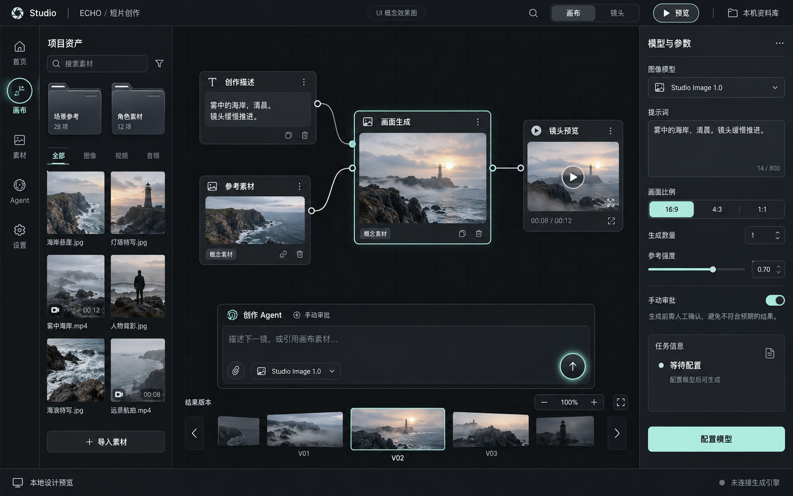

# Scrolltide 组件替换：设计与实施方案

日期：2026-10-25（Asia/Singapore）

状态：**供审阅的方案草案；尚未实施，也未视为用户已选定具体组件、颜色或技术方案。**

最初要求是先写设计和方案。本文合并记录来源、设计、实施步骤、验收和后续衔接。方案交付后，用户明确要求开始下一步；现已用 Image Gen 生成第一张主工作台效果图，见 §12。首页和无素材版本尚未生成。实施章节中的待创建代码文件仍是计划，不代表已存在。

## 1. 结论与范围

建议采用 **Scrolltide 原组件 + 工作台适配层**：用它的光场背景、项目卡、文件夹、操作按钮、发送按钮和媒体切换，重建现有界面的主要视觉；沿用现有产品的项目、资产、Agent、画布、模型设置和任务信息结构。

预期效果是黑银色的影像创作空间：入口有明显的光场与空间层次，工作台用稳定的深色面板承载内容，按钮和卡片在操作时产生可见反馈。换掉图片、没有图片时，导航、容器和动效仍然成立。

这次替换覆盖 UI 层。Electron、本机引擎、自配模型、资产存储、远程服务仍按既有产品设计推进。生成、保存、连接测试等能力不能因换 UI 就被标为完成。

### 用户要求与本方案建议

| 项目 | 来源 / 状态 |
| --- | --- |
| 用 Scrolltide 里的组件替换现有组件 | 本次用户明确要求；作为新的组件来源方向 |
| 先写设计和方案 | 本次用户明确要求；当前交付边界 |
| 方案后使用 Image Gen 看 UI 效果 | 用户此前提出；本文先准备生成 brief |
| 不依赖某一张封面维持界面风格 | 既有设计文件记录的用户反馈，本次继续落实 |
| 黑银表面、低饱和冷光、具体组件组合 | 设计者建议，待效果图和用户反馈校准 |
| 独立 React 预览验证，再迁入正式 renderer | 工程建议，不表示恢复已暂停的 React Bits 方案 |

### 三种路线及取舍

| 路线 | 做法 | 适配代价 | 判断 |
| --- | --- | --- | --- |
| A. 整屏模板替换 | 以 Workspace Hub 等整屏为基础重排全部页面 | 页面原本服务看板，画布、长表单、资产操作仍要重做；迁移范围大 | 不作为首选 |
| **B. 原组件适配（建议）** | 获取选定组件源码或官方提示词，将外观与动画接入工作台的数据和动作 | 需要处理焦点、键盘、状态、媒体和动画生命周期 | 对应用户“用里面的组件”，也能保留现有产品结构 |
| C. 只按预览自行仿制 | 根据公开外观独立写相似效果 | 外观可能偏离，不能称为已使用原组件 | 只有用户接受此替代路线时再采用 |

本文按 B 编写可审阅方案，**B 是推荐项，不记录成用户已经选择**。若源码暂不可用，可以先完成效果图；对应的代码接入任务等待来源就绪，不暗中用其他库替代。

## 2. 现状和真实替换基线

### 本次检查得到的事实

| 文件 / 目录 | 当前情况 | 本次用途 |
| --- | --- | --- |
| `docs/design/libtv-ui-system-study-2026-10-24/` | 原生 HTML/CSS/JS 的完整页面与组件研究样板，含首页、资产、Agent、工作区、设置和弹层 | **页面、基础控件与状态合同的主要基线** |
| `prototypes/motion-v2/` | 已有交互与动效样机；多个预览依赖同一张 `portal.png`；生成和 Agent 都是本地演示 | 节点拖动、缩放、抽屉、转场的交互参考；固定图片依赖是本次要解决的问题 |
| `prototypes/motion-v3/` | React Bits 的 LightPillar、Dock、StarBorder 尝试；方向文件明确写着已暂停、未验证交付 | 保留历史，不用作当前方案的实现基线 |
| `docs/design/getlayers-source-selection.md` | 上一轮 GetLayers 来源选择；原版素材和源码未取得 | 历史参考；本次来源方向以用户新指定的 Scrolltide 为准 |
| `docs/superpowers/specs/2026-10-24-electron-studio-design.md` | 正式产品与架构设计 | 保持既定业务与引擎边界 |
| `docs/superpowers/plans/2026-10-25-desktop-image-workflow.md` | P1 真实图像工作流实施计划，Task 8 是 UI 接入 | 本方案的正式工程落点；不重复规划后端 |

不能把目录名中的 V3 当作最新批准版本。本文修正前期浏览时“以 Motion V3 为基线”的临时判断；V2 也不是全部页面规格的替代品。

### 已核对的代码入口

- `studio.js`：`home`、`assetsPage` / `renderAssets`、`agentPage`、`workspace` / `workspaceBody` / `canvasContent`、`settings` / `settingContent` 对应页面；`button`、`controls`、`modelTrigger`、`stepper`、`jobPanel` 对应基础组件。
- 同文件的 `openModel`、`openPopover`、`openMenu`、`openDialog`、`requestClose`、`showCommand` 定义选择器、菜单、脏表单退出和命令入口；这些行为要保留。
- V2 的 `homeMarkup`、`workspaceMarkup`、`navigate`、`drawWires`、`selectNode`、`togglePanel`、`applyMotionPreference` 提供动效和编辑行为参考。
- `runDemo`、`showAgentRun` 等是演示数据源，不能迁入正式版作为任务成功、连接成功或 Agent 执行依据。

当前研究样板与 V2 有历史验证记录。本轮检查的是源码和记录，未重新跑本地界面，因此不把历史测试写成本次通过。

## 3. Scrolltide 来源核验与获取路径

核验时间：2026-10-25。以下是公开页面及浏览器可见内容，不是已下载的组件源码。

| 来源 | 已核实事实 | 使用边界 |
| --- | --- | --- |
| [Components](https://www.scrolltide.co/components) | 有 Send Halo、Glow Ring Button、Showcase Card、Card Folder、Reel Slider、Light Cove、Mesh Flow、Step Accordion、Step Path 等条目；入口说明组件属于 Yearly / Lifetime | 名称、分类与公开描述已核对；不能从目录存在推导组件已取得 |
| Send Halo 详情（在 Components 中打开） | 已打开详情并查看预览画面；显示环形发送按钮及 “Unlock with Yearly or Lifetime” | 当前会话未取得可复制提示词或源码；未验证原组件的输入联动和键盘行为 |
| [UI](https://www.scrolltide.co/ui) | Workspace Hub 是含胶囊导航和搜索区的完整屏幕；Project Roadmap、Gallery Storefront 等也存在 | 只借用适合工作台的局部结构，业务内容另行设计 |
| [FAQ](https://www.scrolltide.co/faq) | 官方介绍提示词生成 React 的用法，并说明套餐提供原始源码选项 | 单个候选能下载哪些文件，要到实际账户/交付内容核实 |
| [Terms](https://www.scrolltide.co/terms) | 条款描述个人/客户网站使用，限制模板或提示词本身的再分发，以及宣传素材的再利用 | 不把预览视频当产品背景；正式 Electron 分发前核对授权是否涵盖该用途 |

本次没有登录、购买、下载受限文件或将本地项目上传到 Scrolltide。账户权限未知，不把当前浏览器的锁定入口当作“用户肯定没有会员”。

### 来源就绪的判定

1. 优先使用用户可访问账户中的官方组件下载；若只有提示词，则记录为“官方提示词生成”，不得写成“原版源码”。
2. 每项记录名称、页面、取得日期、交付形态、文件校验值、依赖、授权记录和本地修改说明。
3. 先运行原始交付的最小示例，核对是否与预览一致，再封装为工作台组件。实际下载能力和依赖在这一步确定。
4. 尚未取得的项在来源清单中标 `unavailable`，不写入 `vendor` 空壳，不用相似开源组件冒充。
5. 公开预览仅供设计观察；实现使用获准源码或提示词，产品媒体使用本地用户素材和自有占位图。

## 4. 组件替换清单

下表的“首批”是建议实施范围；“可选”不应自动扩大第一批。Scrolltide 的动画描述来自公开目录，尺寸、状态映射和适配方法是本产品设计。

| 现有区域 / 组件 | Scrolltide 候选 | 具体替换方式 | 优先级 |
| --- | --- | --- | --- |
| 首页固定海报式背景 | **Light Cove** | 使用独立光场，集中于页头/入口；用户封面只进项目卡。背景无图也成立 | 首批 |
| 首页项目卡 / `home` | **Showcase Card** | 卡片常显名称、最近编辑、打开入口；展开时呈现镜头数和项目说明；空封面保留材质和几何 | 首批 |
| 导航激活项 / `AppSidebar` | **Glow Ring Button** | 将环光用于当前导航图标，不让整排同时闪动；文字标签固定，不因 hover 改宽 | 首批 |
| Agent 发送 / `agentPage`、V2 composer | **Send Halo** | 空白输入禁用；有有效内容时环光变亮；发送中锁定重复提交，停止动作有独立语义 | 首批 |
| 预览、打开项目等次操作按钮 | **Liquid Glass Button** | 只用于少量独立动作；删除、报错、待审批等仍用清楚的实色语义 | 首批 |
| 资产文件夹 / 分组入口 | **Card Folder** | 复用文件夹折口和展开反馈；固定标签/数量，点击进入文件夹，操作按钮独立命中 | 首批 |
| 结果版本 / 镜头预览条 | **Reel Slider** | 用于单项聚焦的版本比较；一次只播放当前媒体；普通素材网格与时间线编辑仍独立 | 首批 |
| 创建流程 / Agent 计划 | **Step Accordion** | 手动展开步骤、输入、预计输出；移除营销式自动轮播，不自动批准 | 可选第二批 |
| 生成任务阶段 / `jobPanel` | **Step Path** | 由真实阶段推进；未知进度只显示状态，不按固定时长画成完成 | 可选第二批 |
| 首页搜索与页头布局 | **Workspace Hub** | 参考搜索和导航排列；移除销售/会议等不适用内容，不整屏搬运 | 结构参考 |
| 空白画布氛围 | **Mesh Flow** | 仅空白/未操作画布可低幅响应指针；拖动、框选、连线时停用 | 可选性能试验 |
| 节点、模型选择、参数表单、菜单与弹窗 | 当前语义组件 + 统一 token | 保留精确输入、焦点、脏表单确认和节点端口，统一材质；目前没有核实一一对应的 Scrolltide 替代项 | 必须适配 |

**首批最小组合为七项：Light Cove、Showcase Card、Glow Ring Button、Send Halo、Liquid Glass Button、Card Folder、Reel Slider。** 不为凑数量加入 3D 地球、粒子文字、全屏滚动隧道或开场加载秀。那些效果不解决当前工作流问题。

## 5. 视觉设计

### 5.1 基础语言

建议方向：**黑银表面 + 局部冷光 + 清晰媒体边框**。最亮区域是当前操作与媒体内容，次亮区域是标题和选中轮廓。细线、内缘反射和层次变化构成风格，用户素材不参与全局调色。

| 项目 | 建议值 / 规则 |
| --- | --- |
| 主背景 / 外壳 | `#0C0E11` / `#12151A` |
| 普通面板 / 浮层 | `#191D23` / `#222832` |
| 分隔 / 控件边界 | `#2C333D` / `#566170`；关键控件轮廓需实测对比度 |
| 主字 / 次字 | `#F1F3F5` / `#B7C0CC` |
| 强调色 / 强调色文字 | `#B9F3E4` / `#10231D`；环光允许银白到低饱和青色过渡 |
| 成功 / 警告 / 错误 | `#94D9B5` / `#F0C77C` / `#F09C9C`，同时有文字与图标 |
| 字体 | 系统中文 UI 字体；正文 14/22，控件 13/20，元信息 12/18，页标题 24/32 |
| 间距 | 4、8、12、16、20、24、32；页面 24–32，编辑器内部 12–16 |
| 圆角 | 输入 8，按钮 10，卡片 16，弹层 18；只对适合的按钮采用胶囊 |
| 命中区 | 默认按钮高 36，主按钮 40，紧凑图标至少 32×32；触控方案至少 44×44 |
| 玻璃效果 | 仅短小浮动工具条/特定按钮；参数正文与长对话用实色面板 |

上述数值是提案，尚未通过完整对比度或渲染验收。不得将它们说成 Scrolltide 原始 token。

### 5.2 分层

- L0：固定底色与入口光场；背景不接收指针事件。
- L1：侧栏、文档栏、画布网格；几何稳定。
- L2：项目卡、资产、节点、媒体槽；使用一致边界和占位状态。
- L3：当前选择、浮动工具条、Agent 输入；环光只作视觉反馈。
- L4：菜单、选择器、检查器抽屉、表单对话框；焦点与遮罩先于装饰。

所有选中、失败、禁用、连接状态都能在静态截图里辨认。环光和背景运动不携带唯一的业务含义。

## 6. 页面设计

### 6.1 项目首页

左侧保留主导航，顶部为资料库/搜索/新建项目。主区上方是一块约 240px 高的 Light Cove 创作入口，承载“继续创作”和快捷输入；光场独立于任何影片封面。下方用 Showcase Card 展示最近项目，再放文件夹与最近任务。

最近项目默认最多 6 个，更多项目进入完整列表。项目标题和“打开”不藏在 hover 内；封面缺失显示固定图标、项目名与纹理边界。主页没有项目时保留同样的外壳、光场和新建入口。

### 6.2 画布工作台

桌面基准 1440×900，标题栏 36px，工作区工具栏 48px，底部状态栏 24px。编辑时导航折为 64px，左资产栏默认 224px，右检查器 280px，中间给画布约 840px。实际排版以容器剩余空间为准，不对整页使用缩放。

```text
┌ 标题栏 / 项目文档 / 窗口控制 ──────────────────────────┐
├ 导航 ┬ 项目工具栏 / 画布・镜头 / 保存与任务状态 ─────────┤
│      │ 资产栏  │      画布与节点       │ 检查器        │
│      │ 文件夹  │ 提示 → 图像 → 预览    │ 模型 / 参数   │
│      │ 素材    │                      │ 当前任务      │
│      │         │ Agent 输入条          │ 主操作        │
├──────┴─────────┴ 结果版本条 / 可收起 ──┴───────────────┤
└ 状态栏 / 资料库 / 同步或离线状态 ──────────────────────┘
```

图示是布局关系，非像素效果图。节点保持二维坐标与固定端口；不将 Carousel 的透视带入节点拖动。选中边框用同一强调色。工作区默认关闭 Light Cove 的持续光场，只留下稳定底色与网格；Mesh Flow 也不作为首批必备。

Agent composer 在画布底部，最大宽 680px，与缩放控件错开。打开结果条时向上避让；连续输入和打开弹层不能挤压节点坐标。Reel Slider 表示结果浏览，不等同于可剪辑时间线。

### 6.3 资产库

顶部搜索、来源、媒体类型和排序；中间保留普通网格/列表，文件夹使用 Card Folder。默认缩略图居中裁切、详情保留原始比例；坏图和超长名称不能改变卡片高度。详情 drawer 展示版本、来源、尺寸与加入画布动作。

Reel Slider 只用于当前素材的版本比较或独立“浏览”视图。批量选择、过滤和拖入画布时使用稳定网格；切换视图保留当前来源、搜索条件和选中 ID。

### 6.4 Agent

会话列表、对话、计划/执行侧栏的关系保持不变。Send Halo 是核心可感知替换。输入为空、中文输入法合成中、提交中分别处理；回车只在完成合成后提交，Shift+Enter 换行。

计划区后续可用 Step Accordion 展示每一步的输入、产物、模型与费用信息。点击展开仅查看，执行必须走现有批准动作。错误留在发生步骤；停止和重试分别表达业务含义。

### 6.5 模型设置、任务与弹层

设置页仍是二级导航 + 分组行，模型选择器仍包含供应方、能力、连接状态和限制。输入、数值步进、选择器和确认框只统一 token，不为动画更改其含义。

任务阶段可以借用 Step Path 的连接关系，但按已确认状态推进；不能用滚动位置或自动播放代表生成进度。付费批准、凭据输入和破坏性操作使用稳定表单与明确文案。关闭脏表单继续显示放弃确认。

### 6.6 尺寸与窗口变化

| 条件 | 布局行为 |
| --- | --- |
| 1440×900 | 允许资产栏与检查器同时展开；画布主内容优先 |
| 1100×720 | 导航 64px；默认资产栏关闭，检查器 256px；Agent 详情与检查器互斥 |
| 宽度低于 1100px | 资产、检查器改抽屉；保留关闭、搜索、生成和当前选择入口 |
| 高度不足 | 面板内部滚动，动作区固定在可见底部；不让整个窗口横向滚动 |
| Windows 125% / 150% / 200% | 按实际可用逻辑像素布局，逐项验证截断和焦点；不能以浏览器缩放测试冒充系统 DPI 验收 |

## 7. 动效与状态合同

这些时长是产品设计目标，实施时按实际组件可配置能力适配，并记录偏差。

| 触发 | 建议动效 | 减少动态效果 / 资源约束 |
| --- | --- | --- |
| 首页进入 | 外壳立即可用；内容 240–360ms 淡入；光场低速运行 | 直接出现 + 静态底色；不设强制开场等待 |
| 导航切换 | 选中环 160–220ms，文字与命中区固定 | 静态选中轮廓 |
| 项目卡聚焦 | 约 220ms 的展开/边缘反馈，标题位置固定 | 静态边框；键盘 focus 能访问同样内容 |
| 打开项目 | 320–420ms 的封面到工作区过渡 | 立即切换或短淡入；不阻塞必要控件 |
| Send Halo 就绪 | 有效输入时约 160ms 亮起；按下反馈约 100ms | 保留 disabled / busy / label，移除循环光效 |
| 结果切换 | 240–320ms 聚焦切换 | 直接切换；焦点媒体之外的视频暂停 |
| 打开抽屉 | 180–240ms 位移与淡入 | 直接打开；焦点仍正确移动 |
| 节点拖动 / 连线 | 立即跟手 | 不叠加透视、弹跳、节点尺寸动画 |

共同合同：

1. `effectiveReducedMotion = systemReducedMotion || userReducedMotion`。页面不可见时停止装饰 RAF/计时器和预览视频；返回时从当前业务状态恢复。
2. 首页最多一个背景 canvas/WebGL 实例。卸载时释放监听、RAF、观察器、材质、纹理和上下文拥有的资源；失败或 context lost 时显示静态底色，控件仍可用。
3. 同时最多播放一个预览媒体。应用失焦不冒充任务暂停；后台真实任务继续与否由引擎决定。
4. 不拦截全局 wheel，不接入全局 Lenis；长表单、列表、画布缩放各自拥有滚动输入。轮播只消费自身已聚焦/命中的操作。
5. 所有卡片有 click / Enter 路径；hover 只能补充反馈。控件必须覆盖 default、hover、focus-visible、pressed、disabled、busy、error。
6. 空、0 项、1 项、长标题、竖图、横图、无图和坏图均可用；空轮播不启动动画，也不计算不存在的活动索引。
7. 状态只由传入数据决定。视觉组件不请求模型、不写数据库、不保存密钥，也不按动画结束回调生成“业务成功”。

## 8. 下一步 Image Gen 效果图 brief

本节为统一出图 brief。目前已生成图 01 的第一版概念稿，图 02、03 等主工作台视觉反馈后补充。三张图沿用同一视觉系统：

| 图 | 画面重点 | 必须验证的设计问题 |
| --- | --- | --- |
| 01 主工作台，16:10 | 画布节点、资产栏、检查器、Send Halo 输入条、紧凑 Glow Ring 导航、底部版本条 | 媒体与工具的主次、面板密度、可操作感 |
| 02 项目首页，16:10 | Light Cove、搜索/创作入口、Showcase Card、Card Folder | Scrolltide 组件带来的特色是否明显，是否仍像创作工具 |
| 03 无素材工作台，16:10 | 与图 01 完全相同的外壳，仅保留空节点、空资产、引导信息 | 移除图片后，风格与层级是否仍成立 |

统一提示词约束：高保真桌面软件 UI，正面平视，无设备外框；中文为主，标题简短，项目名可用 ECHO；黑银表面、低饱和青色环光、真实控件比例、明确资产/画布/参数区；光场不覆盖正文；不使用宇航员大海报作背景；不出现销售指标、订阅促销、虚构财务统计或整屏霓虹 HUD。

生成时优先引用用户已有概念稿或获准参考图，并说明其用途。若没有可用参考图片，使用本文的描述生成全新概念稿，不声称像素级复刻 Scrolltide。Image Gen 的文字与动效能力有局限，效果图用于确认布局与材质；组件原版、动画、键盘和性能仍要在代码预览中核验。

输出标注“UI 概念效果图”。图 01 与图 03 的相同结构是验收重点；不会把一张好看的有素材截图当作组件系统完成。

## 9. 实施方案 / Implementation Plan

> **For agentic workers:** 获准实施后使用 `superpowers:executing-plans` 逐任务推进；若用户选择并行实施，再使用 `superpowers:subagent-driven-development`。本轮仅规划。

**Goal:** 将七项首批 Scrolltide 组件接入可验证的工作台 UI，并建立向正式 Electron renderer 迁移的边界。

**Architecture:** 现有完整设计样板负责页面与交互基线，V2 负责局部动效参考。新建隔离的 React 预览 `prototypes/scrolltide-study`；原始来源、适配组件、页面和演示数据分层。正式产品接入发生在原 P1 计划 Task 8，不在视觉样机阶段复制引擎。

**Tech Stack:** React + TypeScript + Vite + CSS variables；复用本地 Lucide 资产/同体系图标。先审计实际源码依赖，仅对所选组件必要的动画库增加依赖；不预装 GSAP、Framer Motion、Three.js、Lenis 全家桶，不照抄已暂停 V3 的版本号。

**Spec:** 本文 §1–8；正式业务依据见原 Electron 设计与 P1 实施计划。

### Global Constraints

- 本批只改 UI；原型数据明确标“演示”，正式版数据通过 `WorkspaceConnection` 获取。
- 首批最小组合为七项：Light Cove、Showcase Card、Glow Ring Button、Send Halo、Liquid Glass Button、Card Folder、Reel Slider。
- 桌面基准 1440×900，最小目标 1100×720；正文 14/22，控件 13/20。
- `effectiveReducedMotion = systemReducedMotion || userReducedMotion`。
- 首页最多一个背景 canvas/WebGL 实例；同时最多播放一个预览媒体。
- 空素材不改变界面材质；不拦截全局 wheel；没有后端事实就不显示真实成功。
- 原版源码、官方提示词生成、独立实现三种来源必须分别标记。

### Review Focus

| 易遗漏条件 | 期望行为 | 验证归属 |
| --- | --- | --- |
| 中文输入法合成时按 Enter、连续发送 | 不误发；一个用户提交意图最多触发一次回调 | Task 3 |
| 轮播筛选后为 0/1 项、移除当前项 | 不越界、不隐藏关键操作、焦点可恢复 | Task 4 |
| 项目 A 的旧回调晚于切到 B | 不改写 B 的选择、任务文案或媒体 | Task 5 |
| 隐藏窗口、减少动态效果、WebGL 丢失 | 停止装饰循环，保持可操作的静态界面 | Task 2、6 |
| 键盘开浮层、编辑后退出、窄窗口 | 焦点可见、Escape 返回触发器、脏表单不静默丢失 | Task 3、5 |

### 文件和接口边界

计划新增 `prototypes/scrolltide-study/`：

| 文件 | 职责 |
| --- | --- |
| `README.md`、`package.json`、`package-lock.json`、`index.html`、`vite.config.ts`、`tsconfig.json`、`playwright.config.ts` | 启动、构建、版本与浏览器验证入口 |
| `sources/registry.json`、`THIRD_PARTY_NOTICES.md` | 来源、交付形态、授权、hash、依赖与适配记录 |
| `src/vendor/scrolltide/<item>/` | 实际取得的原始交付；缺失项不创建假源码 |
| `src/styles/tokens.css`、`src/styles/layout.css` | 唯一视觉 token 与布局规则 |
| `src/motion/MotionProvider.tsx`、`src/motion/useMotionPolicy.ts` | reduced motion、visibility 与动效资源策略 |
| `src/components/{AmbientBackdrop,NavigationRail,StudioButton,AgentComposer,ProjectCard,AssetFolder,ResultReel}.tsx` | 七项来源组件的产品适配封装 |
| `src/components/{StudioShell,Inspector,ModelPicker,StudioDialog}.tsx` | 稳定布局与关键业务语义控件 |
| `src/pages/{ProjectHome,AssetLibrary,AgentWorkspace,CanvasWorkspace,ModelSettings,ComponentGallery}.tsx` | 五个页面与独立组件检查页 |
| `src/contracts/ui.ts`、`src/demo/fixtures.ts`、`src/demo/session.ts`、`src/App.tsx`、`src/main.tsx` | 类型、显式演示数据、演示事件的项目归属与应用装配 |
| `tests/{motion,composer,overlays,media,workspace}.spec.ts`、`docs/validation.md` | 行为回归、浏览器证据与未测项 |

所有以下接口是新方案合同，并非 Scrolltide 已有 API；厂商实际 props 差异由适配层吸收。

```ts
type MotionPolicy = { reduced: boolean; visible: boolean };
type MediaItem = { id: string; kind: 'image' | 'video' | 'audio';
  title: string; src?: string; poster?: string; status: 'ready' | 'loading' | 'error' };
type SubmitIntent = { projectId: string; text: string };
type OperationState = 'idle' | 'busy' | 'error';
type WorkspaceRoute = 'home' | 'assets' | 'agent' | 'workspace' | 'settings' | 'components';

// 返回政策，不直接决定业务任务是否继续。
useMotionPolicy(): MotionPolicy;
// 以下均为 React 组件 props 合同，JSX 渲染返回 ReactNode。
AmbientBackdrop({ mode: 'home' | 'workspace', policy: MotionPolicy });
NavigationRail({ active: WorkspaceRoute, onNavigate: (route: WorkspaceRoute) => void });
StudioButton({ variant: 'primary' | 'secondary' | 'ghost' | 'danger',
  state: OperationState, disabled?: boolean, label: string, onPress: () => void });
AgentComposer({ projectId: string, value: string, state: OperationState,
  onChange: (text: string) => void, onSubmit: (intent: SubmitIntent) => void });
ProjectCard({ id: string, title: string, cover?: MediaItem, onOpen: (id: string) => void });
AssetFolder({ id: string, title: string, count: number, onOpen: (id: string) => void });
ResultReel({ items: MediaItem[], selectedId: string | null,
  onSelect: (id: string) => void, policy: MotionPolicy });
```

### Task 1：来源就绪与效果图确认

**Files:** 本 change 的 `assets/`、`imagegen-brief.md`；预览目录的 `sources/registry.json`、`THIRD_PARTY_NOTICES.md`。

**Interfaces:** 产出每项来源状态 `unavailable | original-source | official-prompt-output` 和对照效果图；后续任务只消费已记录可用的项。

- [ ] 按 §8 生成主工作台、首页、无素材工作台概念图，记录提示词和输出；先展示主工作台供判断。
- [ ] 根据用户反馈更新 §5–7 与候选清单；此时才将具体视觉方向从建议改为已选。
- [ ] 通过用户有权访问的入口取得首批组件；核对交付、许可范围、依赖和必要文件。未取得则明确该组件仍不可接入。
- [ ] 最小运行原始组件，记录截图与操作结果；对照官方预览，不将静态视频误记为交互组件。
- [ ] 检查七项登记完整、无临时远程演示资产、无硬编码外部服务。阶段产物为“可接入来源清单 + 选定视觉”，不是已替换界面。

### Task 2：外壳、token 与背景生命周期

**Files:** 初始化预览工程；创建 `tokens.css`、`layout.css`、`MotionProvider.tsx`、`useMotionPolicy.ts`、`AmbientBackdrop.tsx`、`StudioShell.tsx`、`ui.ts`、`main.tsx`、`App.tsx`、`motion.spec.ts`。

**Interfaces:** 产出 `MotionPolicy`、`useMotionPolicy()`、`AmbientBackdrop`，供后续组件统一使用。

- [ ] 锁定可用工具链与依赖；添加 `dev`、`build`、`typecheck`、`test:ui` 脚本，预览只绑定回环地址。
- [ ] 在 `motion.spec.ts` 先写行为断言：系统 reduced 或应用 reduced 任一为 true 时持续动效关闭；进入工作区后首页背景卸载；WebGL 创建失败仍显示内容与操作按钮。
- [ ] 运行 `npm run test:ui -- tests/motion.spec.ts`，记录缺实现导致的失败，再实现政策和外壳；不为每个色值编写镜像测试。
- [ ] 接入 Light Cove，保持首页最多一个实例；监听与 GPU 资源全部有清理入口；画布用静态底色。
- [ ] 复跑上述用例与 `npm run build`；在 1440×900、1100×720 检查壳体，记录截图和溢出情况。

### Task 3：导航、按钮、输入与弹层

**Files:** 创建 `NavigationRail.tsx`、`StudioButton.tsx`、`AgentComposer.tsx`、`ModelPicker.tsx`、`StudioDialog.tsx`、`composer.spec.ts`、`overlays.spec.ts`；修改 `App.tsx`、`ui.ts`。

**Interfaces:** 产出 §9 的导航、按钮与 composer props；`StudioDialog` 受控于 `open`，接受 `onRequestClose`，关闭检查由上层表单负责。

- [ ] 先写 composer 用例：trim 后为空不提交；composition 期间 Enter 不提交；正常 Enter 只提交一次；busy 状态连续点击无重复回调；Shift+Enter 保留换行。
- [ ] 先写 overlays 用例：键盘打开模型选择器后聚焦搜索；Escape 回到触发器；未保存表单关闭先出现确认，“继续编辑”保留值。
- [ ] 执行 `npm run test:ui -- tests/composer.spec.ts tests/overlays.spec.ts` 记录失败，再接入 Glow Ring、Liquid Glass、Send Halo 并实现上述行为。
- [ ] 检查原组件是否用非语义 div 模拟按钮；通过适配层提供真实 button、名称、disabled 和 busy 语义。
- [ ] 复跑本任务用例，检查长标签、键盘焦点与纯色背景；光环变化不改变按钮尺寸。

### Task 4：项目卡、文件夹与结果浏览

**Files:** 创建 `ProjectCard.tsx`、`AssetFolder.tsx`、`ResultReel.tsx`、`ProjectHome.tsx`、`AssetLibrary.tsx`、`fixtures.ts`、`media.spec.ts`。

**Interfaces:** 使用 §9 的卡片与 `MediaItem` 合同；`selectedId` 由页面持有，过滤后不存在时设为首个可用项 ID，空列表设 null。

- [ ] 先写用例：0 项显示空态；1 项不显示无效上一项/下一项；当前项被过滤后选中 ID 有效；切换网格/列表不改变来源与搜索条件。
- [ ] 加入无图、加载失败、中文长标题、横竖比例混合用例；资产名称与打开动作始终可访问。
- [ ] 运行 `npm run test:ui -- tests/media.spec.ts` 确认行为缺口，再接入 Showcase Card、Card Folder 和 Reel Slider。
- [ ] 在可控本地视频夹具上检查：切换结果时旧媒体暂停，最多一个媒体播放，页面隐藏时全部预览暂停；自动播放被拒绝时显示可点击播放按钮。
- [ ] 复跑本任务用例；对照“有图/无图/坏图”三组截图，容器、token 和主操作位置保持一致。

### Task 5：五个页面组合与工作区回归

**Files:** 创建 `AgentWorkspace.tsx`、`CanvasWorkspace.tsx`、`ModelSettings.tsx`、`ComponentGallery.tsx`、`Inspector.tsx`、`session.ts`、`workspace.spec.ts`；修改 `App.tsx`。

**Interfaces:** 演示会话保存 `{ projectId, generation }`；页面切换更新 generation。延迟事件必须同时匹配当前 projectId 与 generation 才能写当前视图；此机制只保护预览，不替代正式引擎契约。

- [ ] 先写回归：进入项目、拖动节点、缩放、打开资产、筛选、应用输入、选择模型、查看版本；动作必须在换皮后仍可用。
- [ ] 测试 A 项目延迟演示完成时已切到 B，B 的文案、选择与媒体不变；测试快速来回切换后没有重复监听/残留弹层。
- [ ] 运行 `npm run test:ui -- tests/workspace.spec.ts` 记录失败，再组合页面和受控状态；演示事件统一来自 session，组件内部不自造成功。
- [ ] 在 1100×720 验证面板互斥、底部动作可达、composer 与结果条不相互覆盖；可点击但未实现的能力明确标演示或不可用原因。
- [ ] 复跑本任务与受影响的媒体/弹层用例；检查工作区滚轮不被结果浏览控件全局截获。

### Task 6：视觉、资源与交付检查

**Files:** `docs/validation.md`、必要截图；只修复前面任务已创建的相关文件。

**Interfaces:** 产出来源清单、实际可运行预览、验证证据和未测项；不能以概念图替代代码验收。

- [ ] 在预览包目录运行 `npm run typecheck`、`npm run build`、`npm run test:ui`；只有实际退出成功才记录通过。
- [ ] 查看首页、工作台、资产、Agent、设置、核心弹层的 1440×900 / 1100×720 截图；检查正文、空态、错误和长内容。
- [ ] 实测系统 reduced motion、应用关闭动效、隐藏/恢复窗口、WebGL context lost、快速路由切换；静态界面仍可完成主要操作。
- [ ] 对 Light Cove 和 Reel Slider 分别观察运行、暂停和切换，记录动画差异；静态截图不能证明动效流畅。
- [ ] 记录实际测得的内存、重复进入后的实例/监听释放与媒体播放情况；无数据就写未测，不声称达到 60fps 或完整产品的 500 节点目标。
- [ ] 汇总首批七项的状态：已获取、已接入、已验证或具体缺口。旧样板保留为对照，避免覆盖用户原工作。

### Task 7：正式产品接入（依赖 P1，不是视觉样机默认执行项）

**Files:** 按原 P1 Task 8 创建/修改 `packages/ui/src/` 与 `apps/desktop/src/renderer/features/`；同步相关组件合同、来源清单和 UI 测试。

**Interfaces:** 页面通过原设计的 `WorkspaceConnection` 消费查询、命令与事件；视觉层继续使用受控 props。

- [ ] 前置条件：正式 Electron/引擎工程已按 P1 建立，本次视觉已获选定，来源允许目标使用方式。
- [ ] 将稳定 token、来源组件和适配层迁入 `packages/ui`；页面组合进入 renderer；预览改为引用同一 UI 包，避免维护两套实现。
- [ ] 删除正式页面中的演示事件源，以真实命令 receipt、任务阶段、资产版本和错误替代；预览 fixture 保留在独立演示入口。
- [ ] 用原 P1 图像工作流的端到端验收核对配置→批准→生成→收存→画布→重开，并在打包 Electron 中验证窗口生命周期和 DPI。

## 10. 验收清单与完成口径

| 层次 | 完成标准 | 本轮状态 |
| --- | --- | --- |
| 设计与方案 | 有来源、基线、对应表、页面/动效合同、任务和可检查的验收点 | 本文已写，待审阅 |
| 效果图 | 同一系统的首页/工作台/无素材图，用户可判断材质与布局 | 主工作台 v1 已生成；首页/无素材图待补 |
| 来源 | 七项实际交付与授权记录完整 | 未取得；公开目录和 Send Halo 详情已核对 |
| 可交互预览 | 七项实际接入；五个页面主要操作与降级可验证 | 未实施 |
| 正式产品 | 接真实引擎并通过 P1 工作流、打包与 DPI 验收 | 未实施 |

方案的成功不以“页面变炫”作为唯一标准：有图和无图都成立；重要操作不会被 hover/轮播隐藏；输入和拖动不受装饰动画干扰；错误、等待、审批与真实完成保持可辨认。

## 11. 文档衔接、回退与当前边界

按上级 `D:/AGENTS.md` 的 change 记录约定，本次长设计与实施方案合并在本文件。该上级文件描述的 OpenCode/Bun 工程目录在本项目中不存在，未将其技术栈强加到 LibTV Studio；本项目已有文档继续作为实际架构依据。

| 既有文档 | 后续融合位置 | 本轮处理 |
| --- | --- | --- |
| `docs/design/getlayers-source-selection.md` | 页首增加新 Scrolltide 方向的链接与状态 | 暂保留历史原文；用户新指定来源以本文为准 |
| `docs/design/libtv-ui-system-study-2026-10-24/design-system.md` | §3 来源、§4 token、页面与组件合同 | 视觉确认后融合，不把草案覆盖成定稿 |
| `docs/superpowers/plans/2026-10-25-desktop-image-workflow.md` | Task 8 UI 接入的来源、组件与验收 | 正式迁移时链接本文；原引擎任务保持其范围 |
| `docs/superpowers/plans/2026-10-25-product-delivery-roadmap.md` | UI 现状与完成度 | 只在真实交付后更新完成状态 |

实施前保存旧样板对照；新预览独立目录；正式替换按组件逐项迁入，某项兼容失败可回到原有语义控件。回退只涉及 UI，不逆转任务、资产或模型调用。

**尚待事实确认：** 首批组件的实际取得渠道与交付文件、目标桌面使用授权、源码的真实依赖及运行表现。**待视觉选择：** 本文建议的黑银冷光、七项组合及效果图细节。它们不阻碍本轮方案交付，也不记录为已获批准。

方案编写阶段未修改产品代码、安装依赖、调用模型或生成图片。其后按用户指示执行的 Image Gen 出图单独记录在 §12；没有接入产品模型或生成引擎。计划中的测试命令是后续执行入口，不能作为本次测试通过证据。

### 本轮文档检查

- 独立实施视角审阅已完成，未提出必须补答的关键规划问题；这不等于视觉已定稿或代码已验收。
- 已核对所引用的现有代码入口和文档路径；未来工程文件在 §9 明确标为待创建。
- 相关依据：[现有 UI 规范](../../../docs/design/libtv-ui-system-study-2026-10-24/design-system.md)、[完整产品设计](../../../docs/superpowers/specs/2026-10-24-electron-studio-design.md)、[P1 实施计划](../../../docs/superpowers/plans/2026-10-25-desktop-image-workflow.md)。

## 12. 主工作台效果图 v1

2026-10-25，用户在确认下一步为主工作台效果图后说“那开始吧”。已使用内置 Image Gen 生成一张新概念图；生成前查看了 V2 工作台截图以核对信息结构，生成请求使用本文的描述，没有将旧截图作为编辑目标，也没有获取 Scrolltide 受限源码或素材。



- 图片：[workspace-v1.png](assets/workspace-v1.png)。
- 完整生成提示词：[imagegen-workspace-v1-prompt.txt](imagegen-workspace-v1-prompt.txt)。
- 已目视检查：左侧资产与文件夹、四个画布节点、右侧参数、Send Halo 风格输入条、当前导航环光、底部结果版本条均可见；黑银冷光材质独立于媒体槽中的海岸图片。
- 这是布局与材质提案。图中的模型名、媒体文件名、数量及预览时码是生成的示意内容；不代表真实配置、已生成视频或已接入的组件。
- 与规范的待校准处：概念图将顶部栏合并呈现，具体栏高和间距仍需代码排版；卡片、轮播和环光的动画、焦点、键盘及性能没有通过静态图片得到验证。
- 生成原件保留在 Codex 默认输出目录；工作区副本已核对 SHA-256 一致。产品代码未改，七项组件源码仍未取得。
